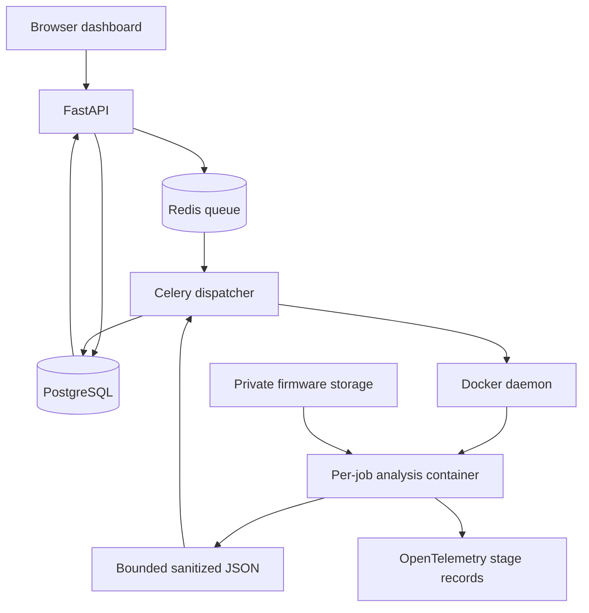

# Architecture

The browser sends authenticated requests to FastAPI. PostgreSQL stores employees, sessions, assessments and findings. Redis carries queued work. Celery workers coordinate jobs; the trusted dispatcher uses the Docker socket to launch analysis containers.

Inside each job: extraction → inventory and ELF protections → selected emulation and symbolic analysis → secret/cryptography scan → normalization. Selected real binaries also receive independent bounded CFG recovery. The control plane stores the sanitized result and exposes it to the browser and report export.

## Trust boundaries

The analysis container has no external network, a read-only root filesystem, dropped capabilities, no privilege escalation, a nonroot workload user and CPU/memory/time/process/output limits. Only the trusted dispatcher has Docker-daemon access; that access is administrative authority over its host. The VM is the host environment, not the only isolation control. Inputs and fingerprint salts are private; ordinary output uses redaction and salted fingerprints.

The API/database/queue communicate on Compose networks. Firmware binaries do not run in those service containers. Storage includes private uploaded bytes, job context, redacted outputs and database records. Configuration secrets stay outside version control.

## Limits

A recovered CFG is static and may be truncated. Selected-check completion does not mean whole-firmware verification. The recorded OpenWrt symbolic path covers a multipart header with an empty body. Job-local HTTP checks use a known marker page, not every firmware web endpoint. See TESTING.md and the submission evidence index for measured scope.
