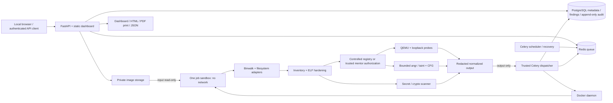

# FirmwareX architecture

## Trust and data boundaries

The API binds to localhost port 8000. PostgreSQL and Redis have no host-published ports and use an internal Compose network. The dispatcher alone has the Docker socket; it is trusted host-authority infrastructure, not a sandbox. Never deploy this development topology as an untrusted multi-tenant service.

Every extraction and target-analysis process runs in a disposable container with no network interfaces beyond loopback, read-only root filesystem, non-root UID, dropped capabilities, no-new-privileges, PID/memory/CPU/wall limits and cleanup. Default Docker seccomp/AppArmor applies. /input is a read-only host mount. /output is a Docker local-driver tmpfs volume capped at 40 MiB and 1,024 inodes, with no host-directory write mount. A supervisor retains the mount after the workload exits; the trusted controller pauses the container and reads only a regular result file of at most 32 MiB through the Docker archive API, without extracting guest tar entries onto the host. Container and temporary volume are removed on completion and orphan recovery. /scratch and /tmp are bounded noexec tmpfs. Pipeline /guest is a 32 MiB executable tmpfs required by QEMU mmap; only hash-checked controlled targets are staged there. These sensitive controls still require mentor/code review.

Raw firmware and per-firmware random salts live in ignored private storage. Extracted trees live only inside the job tmpfs. Findings contain salted HMAC fingerprints, redacted diagnostic evidence, stable UUIDs and explicit confidence. Unknown firmware-derived path components are pseudonymized. User-entered display names are separate metadata and must not contain secrets. Historical records predate the current output policy; universal/historical redaction is still an open acceptance item.

## Lifecycle

Upload runs in the API thread pool so synchronous database admission locks and spooled-file reads do not block the ASGI event loop. It validates provenance, format/size and queue capacity, computes SHA-256, stores the file and commits queued metadata/audit. Redis dispatch is recoverable from durable queued rows. One heavy job runs at a time. The dispatcher launches a pipeline sandbox and persists the normalized findings, inventory, audit records and results. Abandoned jobs expire after the recovery lease and their labeled containers and temporary output volumes are removed. The dashboard polls authenticated APIs. Local OpenTelemetry covers upload, queue, sandbox, analysis stages, persistence and recovery without worker egress. Recoverable emulation/symbolic/graph exceptions mark that stage incomplete while preserving earlier results and allowing independent scanning. An outer process kill still cannot recover an unfinished in-memory report.

## Analysis coverage

Six filesystem adapters; five named ELF/QEMU architectures including distinct MIPS/MIPSEL; metadata-based hardening; bounded source/sink symbolic models; pattern/entropy/crypto candidates. The exact controlled-image registry enables reproducible fixture tests. Separately, trusted deployment configuration enables mentor-authorized real-image sampling (see mentor-authorization.md). It selects at most three supported application executables, stages their guest files into bounded executable tmpfs, and runs timed startup/symbolic probes. Frozen OpenWrt image hashes select a BusyBox true-applet check and a uhttpd loopback HTTP harness with a synthetic page; this is not a full firmware boot or its original web application. Overall sampling remains incomplete even when a specific probe succeeds.

No live-device scanning, shellcode, exploit generation or raw-secret download endpoint exists. Registered controlled fixtures additionally support bounded HTTP/UPnP/MQTT fuzzing, diagnostic crash replay/minimization/deduplication and ARM snapshot restoration. These do not establish arbitrary vendor protocol fuzzing or snapshots. The frontend is buildless JavaScript; CFGs come from angr CFGFast. QEMU TCG works without /dev/kvm. Python 3.12 dependencies and native package snapshots are isolated from system Python.
